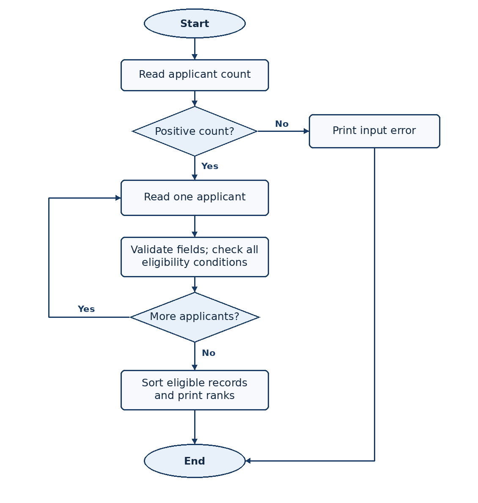
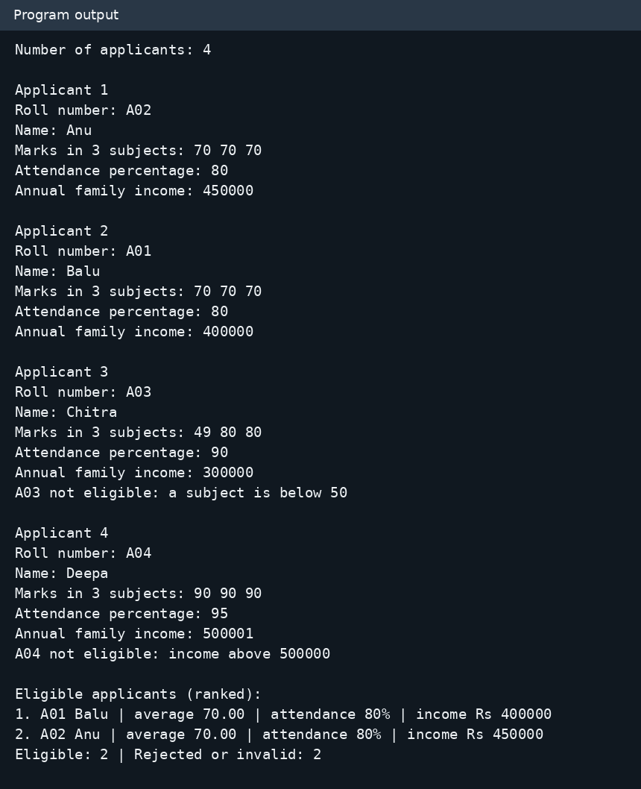

# Case Study 1: University Scholarship Allocation

## Problem statement

Evaluate scholarship applicants using aggregate marks, subject-wise minimum scores, attendance and family income. Rank eligible applicants and resolve ties using the given rules.

## Objectives

Check every eligibility condition, explain rejections and produce a ranked list using lists and tuples.

## Assumptions

- There are three subject marks, each from 0 to 100. The minimum aggregate is 60 and every subject must be at least 50.
- Attendance must be at least 75% and annual family income must not exceed Rs 500000.
- Rank by higher total, then higher attendance, then lower income, then roll number in alphabetical order. Invalid records and repeated roll numbers are rejected.

## Algorithm

1. Read the number of applicants and check that it is positive.
2. For each applicant, read and validate the roll, name, three marks, attendance and income.
3. Check all four eligibility conditions and print the reasons for rejection.
4. Store eligible records in a list and sort them using the stated tie rules.
5. Print the ranks and the numbers of eligible and rejected records.

## Flowchart



## Pseudocode

```text
READ applicant_count
IF applicant_count is not positive THEN PRINT error
ELSE
    eligible = empty list
    FOR each applicant
        READ roll, name, 3 marks, attendance, income
        IF record is invalid THEN PRINT error
        ELSE
            CHECK aggregate, subject minimum, attendance and income
            IF eligible THEN ADD record to eligible
            ELSE PRINT all rejection reasons
    SORT eligible by marks, attendance, income and roll
    PRINT ranks and counts
END IF
```

## Python source code

```python
# Case study 1: University Scholarship Allocation
# Each applicant has three marks out of 100.

count_text = input("Number of applicants: ").strip()
if not count_text.isdecimal() or int(count_text) < 1:
    print("Enter a positive number of applicants.")
else:
    eligible = []
    seen_rolls = []
    rejected = 0

    for number in range(int(count_text)):
        print("\nApplicant", number + 1)
        roll = input("Roll number: ").strip().upper()
        name = input("Name: ").strip()
        mark_text = input("Marks in 3 subjects: ").split()
        attendance_text = input("Attendance percentage: ").strip()
        income_text = input("Annual family income: ").strip()
        errors = []
        marks = []

        if not roll or not name:
            errors.append("roll and name are required")
        if roll in seen_rolls:
            errors.append("duplicate roll number")
        if len(mark_text) != 3:
            errors.append("enter exactly 3 marks")
        else:
            for value in mark_text:
                if not value.isdecimal() or int(value) > 100:
                    errors.append("marks must be whole numbers from 0 to 100")
                    break
                marks.append(int(value))
        if not attendance_text.isdecimal() or int(attendance_text) > 100:
            errors.append("attendance must be from 0 to 100")
        if not income_text.isdecimal():
            errors.append("income must be a non-negative whole number")

        if errors:
            print("Invalid record:", "; ".join(errors))
            rejected += 1
            continue

        seen_rolls.append(roll)
        attendance = int(attendance_text)
        income = int(income_text)
        total = sum(marks)
        reasons = []
        if total / 3 < 60:
            reasons.append("aggregate below 60")
        if min(marks) < 50:
            reasons.append("a subject is below 50")
        if attendance < 75:
            reasons.append("attendance below 75")
        if income > 500000:
            reasons.append("income above 500000")

        if reasons:
            print(roll, "not eligible:", "; ".join(reasons))
            rejected += 1
        else:
            # Negative values arrange the higher total and attendance first.
            eligible.append((-total, -attendance, income, roll, name))

    eligible.sort()
    print("\nEligible applicants (ranked):")
    if not eligible:
        print("None")
    for index in range(len(eligible)):
        negative_total, negative_attendance, income, roll, name = eligible[index]
        average = -negative_total / 3
        print(f"{index + 1}. {roll} {name} | average {average:.2f} | "
              f"attendance {-negative_attendance}% | income Rs {income}")
    print(f"Eligible: {len(eligible)} | Rejected or invalid: {rejected}")
```

## Test cases

| Input | Expected result | Result |
| --- | --- | --- |
| 50, 60, 70; 75%; income 500000 | Eligible at all boundary values | Pass |
| Four equal aggregates with different attendance, income and rolls | Ordered by attendance, income, then roll | Pass |
| Low marks, attendance 74%, income 500001 | All four reasons reported | Pass |
| One mark is non-numeric | Record rejected without a crash | Pass |
| Two records with roll R01 | Second record is rejected | Pass |
| Zero applicants | Input rejected | Pass |

[Automated test cases](test_cases.py)

## Output screenshot



[Sample input](sample_input.txt) · [Captured output](output.txt)

## Conclusion

The program checks all conditions and gives a deterministic ranking, including applicants with tied marks.
