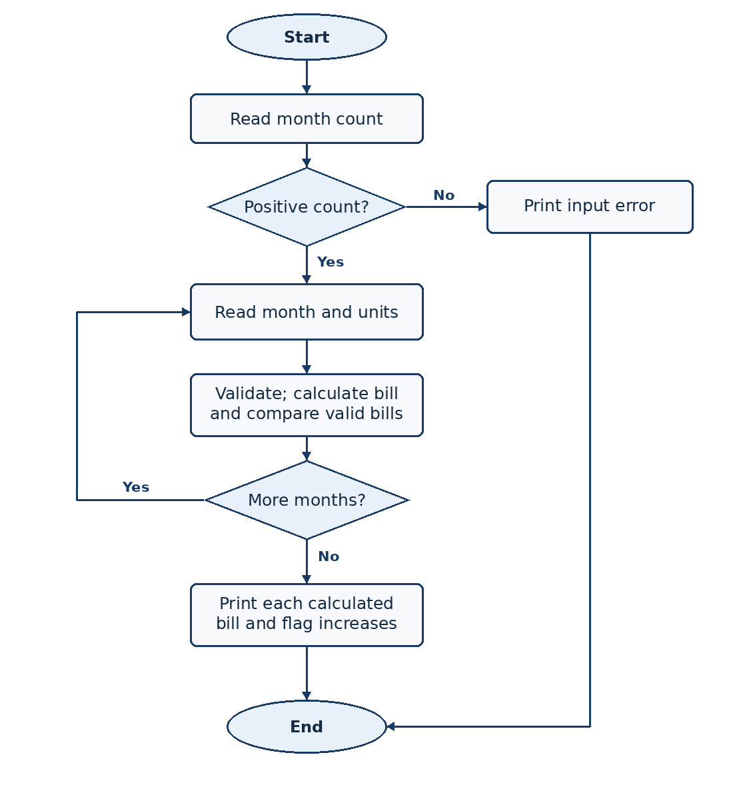
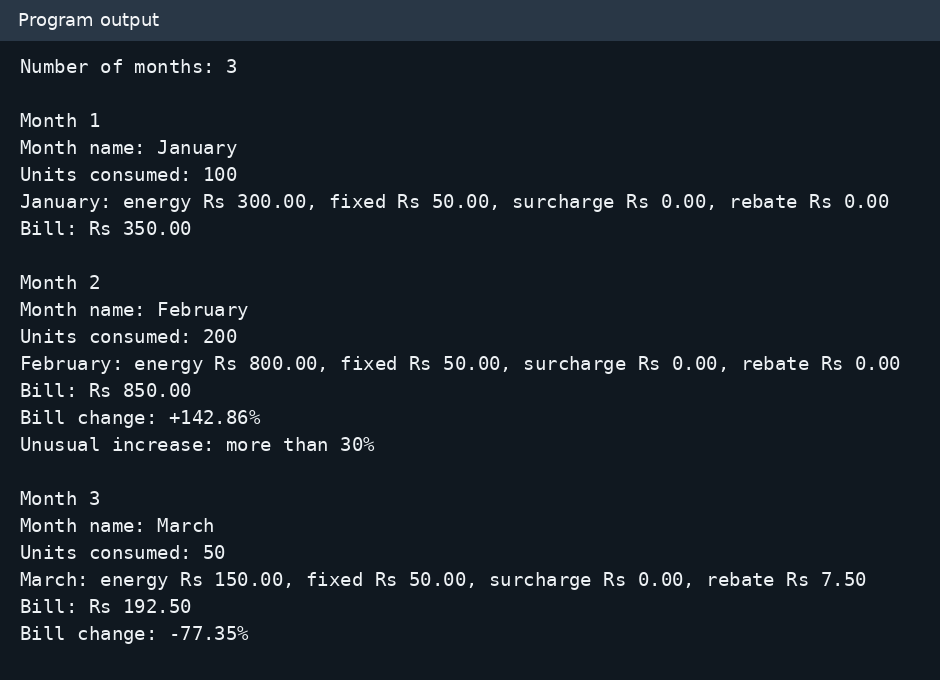

# Case Study 2: Progressive Electricity Billing

## Problem statement

Calculate electricity bills for several months using progressive slabs, a fixed charge, a surcharge and a rebate. Compare the bills and flag unusual increases.

## Objectives

Apply slab-wise arithmetic and compare each valid bill with the previous valid bill.

## Assumptions

- Units are non-negative whole numbers. The first 100 units cost Rs 3 each, the next 100 cost Rs 5 each and units above 200 cost Rs 7 each.
- The fixed charge is Rs 50. A surcharge of 5% of the energy charge applies above 300 units. A rebate of 5% of the energy charge applies when units fall from the preceding valid month.
- An increase greater than 30% in the bill amount is unusual. Invalid records are skipped and the first valid month has no comparison.

## Algorithm

1. Read a positive number of months.
2. For each month, read and validate its name and units.
3. Calculate the energy charge slab by slab, then add the fixed charge and applicable surcharge and subtract the rebate.
4. Print the bill. Compare its amount with the previous valid bill and flag a rise greater than 30%.
5. Save the current valid units and bill for the next comparison.

## Flowchart



## Pseudocode

```text
READ month_count
IF count is invalid THEN PRINT error
ELSE
    previous_units = NONE; previous_bill = NONE
    FOR each month
        READ month, units
        IF invalid THEN SKIP record
        CALCULATE progressive energy charge
        ADD fixed charge and any surcharge
        IF units fell THEN SUBTRACT rebate
        PRINT bill
        IF previous bill exists
            CALCULATE percentage change in bill amount
            IF change > 30% THEN PRINT unusual increase
        SAVE units and bill
END IF
```

## Python source code

```python
# Case study 2: Progressive Electricity Billing
# Charges are calculated separately for every slab.

count_text = input("Number of months: ").strip()
if not count_text.isdecimal() or int(count_text) < 1:
    print("Enter a positive number of months.")
else:
    previous_units = None
    previous_bill = None
    for number in range(int(count_text)):
        print("\nMonth", number + 1)
        month = input("Month name: ").strip()
        units_text = input("Units consumed: ").strip()
        if not month or not units_text.isdecimal():
            print("Invalid month or units; record skipped.")
            continue

        units = int(units_text)
        if units <= 100:
            energy = units * 3
        elif units <= 200:
            energy = 100 * 3 + (units - 100) * 5
        else:
            energy = 100 * 3 + 100 * 5 + (units - 200) * 7

        fixed = 50
        surcharge = 0
        if units > 300:
            surcharge = energy * 0.05
        rebate = 0
        if previous_units is not None and units < previous_units:
            rebate = energy * 0.05
        bill = energy + fixed + surcharge - rebate

        print(f"{month}: energy Rs {energy:.2f}, fixed Rs {fixed:.2f}, "
              f"surcharge Rs {surcharge:.2f}, rebate Rs {rebate:.2f}")
        print(f"Bill: Rs {bill:.2f}")
        if previous_bill is not None:
            change = (bill - previous_bill) * 100 / previous_bill
            print(f"Bill change: {change:+.2f}%")
            if change > 30:
                print("Unusual increase: more than 30%")
        previous_units = units
        previous_bill = bill
```

## Test cases

| Input | Expected result | Result |
| --- | --- | --- |
| 100, 200 and 201 units | Energy charges 300, 800 and 807 | Pass |
| 300 and 301 units | Surcharge applies only above 300 | Pass |
| Units fall from 200 to 100 | 5% energy rebate and -60.59% bill change | Pass |
| 100 then 200 units | Actual bills rise 142.86%, so flag it | Pass |
| 0 units, invalid -4, then 1 unit | No division by zero; invalid record skipped | Pass |

[Automated test cases](test_cases.py)

## Output screenshot



[Sample input](sample_input.txt) · [Captured output](output.txt)

## Conclusion

The bill uses progressive slabs and the comparison is based on bill amounts, not just units consumed.
