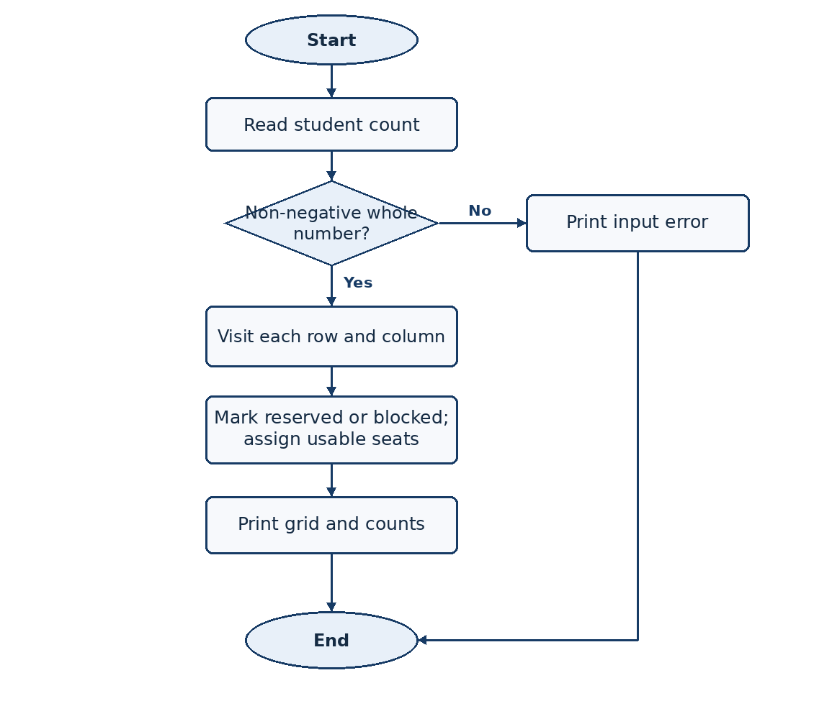
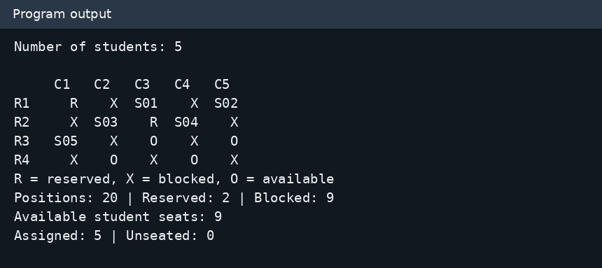

# Case Study 26: Nested Loop Examination Seating Generator

## Problem statement

Generate an examination seating arrangement with row and column identifiers, reserved positions, alternate seating restrictions and a fixed classroom capacity.

## Objectives

Use nested loops to assign students only to allowed positions and report remaining demand.

## Assumptions

- The classroom has 4 rows and 5 columns. Positions (1,1) and (2,3) are reserved and are not available to students.
- After checking reservations, a position is usable only when row + column is even. R means reserved, X blocked and O empty. Students are assigned S01, S02 and so on.
- A non-negative whole-number student count is accepted. Students beyond the nine usable seats remain unseated.

## Algorithm

1. Read and validate the number of students.
2. For each row and column, first mark reserved positions.
3. Block the remaining positions where row + column is odd.
4. Assign students in order to usable positions; mark unused ones O.
5. Print the grid, seat counts and number of unseated students.

## Flowchart



## Pseudocode

```text
READ student_count
IF count is invalid THEN PRINT error
ELSE
    FOR row = 1 TO 4
        FOR column = 1 TO 5
            IF position is reserved THEN PRINT R
            ELSE IF row + column is odd THEN PRINT X
            ELSE IF students remain THEN ASSIGN next student
            ELSE PRINT O
    PRINT available, assigned and unseated counts
END IF
```

## Python source code

```python
# Case study 26: Nested Loop Examination Seating Generator
# The classroom has 4 rows and 5 columns.

reserved = [(1, 1), (2, 3)]
count_text = input("Number of students: ").strip()
if not count_text.isdecimal():
    print("Enter a non-negative whole number.")
else:
    requested = int(count_text)
    assigned = 0
    available = 0
    reserved_count = 0
    blocked = 0
    print("\n     C1   C2   C3   C4   C5")
    for row in range(1, 5):
        line = f"R{row} "
        for column in range(1, 6):
            if (row, column) in reserved:
                seat = "R"
                reserved_count += 1
            elif (row + column) % 2 == 1:
                seat = "X"
                blocked += 1
            else:
                available += 1
                if assigned < requested:
                    assigned += 1
                    seat = f"S{assigned:02d}"
                else:
                    seat = "O"
            line += seat.rjust(5)
        print(line)
    print("R = reserved, X = blocked, O = available")
    print(f"Positions: 20 | Reserved: {reserved_count} | Blocked: {blocked}")
    print(f"Available student seats: {available}")
    print(f"Assigned: {assigned} | Unseated: {requested - assigned}")
```

## Test cases

| Input | Expected result | Result |
| --- | --- | --- |
| 0 students | 9 available; 2 reserved and 9 blocked | Pass |
| 3 students | Only 3 seats assigned | Pass |
| 9 students | All 9 student seats filled | Pass |
| 12 students | 3 remain unseated | Pass |
| Negative student count | Input rejected | Pass |

[Automated test cases](test_cases.py)

## Output screenshot



[Sample input](sample_input.txt) · [Captured output](output.txt)

## Conclusion

Reserved and blocked positions are kept separate and only the nine usable seats are counted as student capacity.
