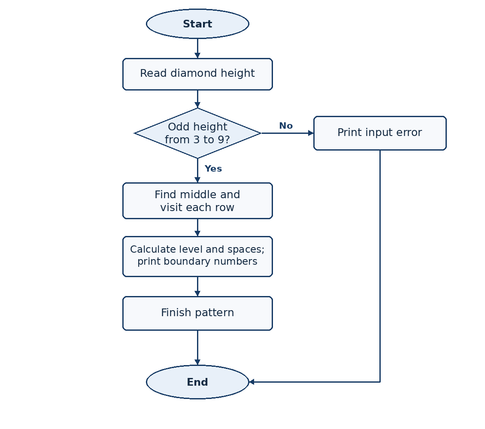
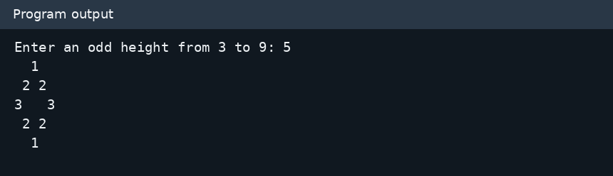

# Case Study 27: Advanced Numeric Pattern Generator

## Problem statement

Produce a hollow numeric diamond for a user-specified dimension, validating invalid dimensions and keeping the rows aligned.

## Objectives

Use loops, arithmetic and spaces to print a symmetric number pattern.

## Assumptions

- The height must be an odd whole number from 3 to 9. The middle row is the widest and the number increases from the edge to the middle.
- The restricted range keeps every printed number one character wide.

## Algorithm

1. Read the height and check that it is odd and between 3 and 9.
2. Find the middle row.
3. For each row, calculate its level, leading spaces and inner spaces.
4. Print the same level number at both ends, except for the single number at the top and bottom.

## Flowchart



## Pseudocode

```text
READ height
IF height is not odd or not from 3 to 9 THEN PRINT error
ELSE
    middle = height DIV 2
    FOR each row
        level = middle - ABS(row - middle)
        PRINT leading spaces
        IF level = 0 THEN PRINT one number
        ELSE PRINT number, inner spaces, same number
END IF
```

## Python source code

```python
# Case study 27: Advanced Numeric Pattern Generator
# Print a hollow numeric diamond of an odd height.

size_text = input("Enter an odd height from 3 to 9: ").strip()
if not size_text.isdecimal():
    print("Invalid height: use an odd whole number from 3 to 9.")
else:
    size = int(size_text)
    if size < 3 or size > 9 or size % 2 == 0:
        print("Invalid height: use an odd whole number from 3 to 9.")
    else:
        middle = size // 2
        for row in range(size):
            level = middle - abs(row - middle)
            digit = str(level + 1)
            spaces = middle - level
            if level == 0:
                print(" " * spaces + digit)
            else:
                print(" " * spaces + digit + " " * (2 * level - 1) + digit)
```

## Test cases

| Input | Expected result | Result |
| --- | --- | --- |
| Height 5 | Five aligned rows forming a hollow diamond | Pass |
| Height 3 | Three aligned rows | Pass |
| Height 9 | Nine-row diamond with 5 at the centre | Pass |
| Height 6 | Rejected because height is even | Pass |
| abc | Rejected without a crash | Pass |
| Height 11 | Rejected because it is above 9 | Pass |

[Automated test cases](test_cases.py)

## Output screenshot



[Sample input](sample_input.txt) · [Captured output](output.txt)

## Conclusion

The diamond is symmetric, and invalid heights are rejected before the pattern is printed.
