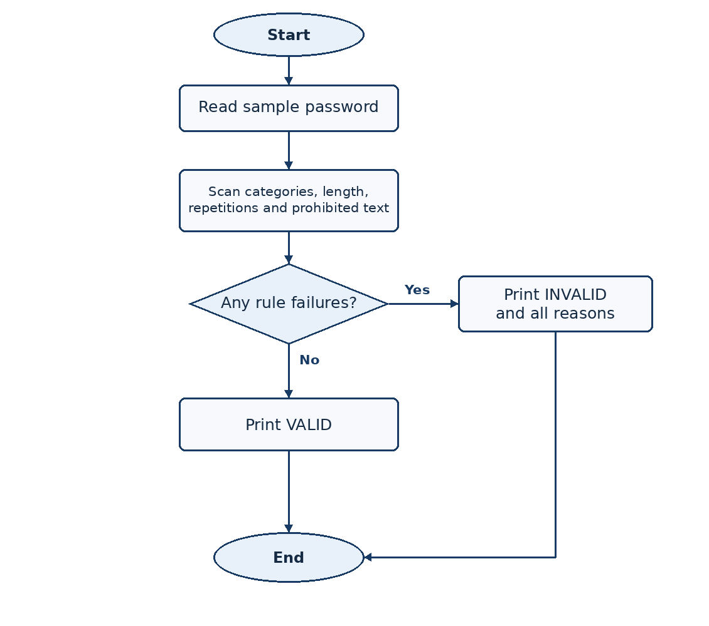
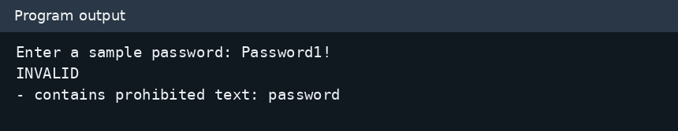

# Case Study 29: Password Policy Validation Engine

## Problem statement

Check sample passwords against length, character-category, repetition and prohibited-substring rules. Explain each failed condition.

## Objectives

Scan a string using loops and report every policy failure rather than stopping at the first one.

## Assumptions

- A password needs at least 8 characters, an ASCII uppercase letter, a lowercase letter, a digit and one character from !@#$%.
- Three identical consecutive characters are not allowed. The substrings password, admin and 123456 are prohibited without regard to letter case.
- All input passwords are hypothetical examples; this is not a real login system.

## Algorithm

1. Read a sample password.
2. Scan its characters for each required category.
3. Check length, three-character repetitions and prohibited substrings.
4. Collect all failed rules and print them, or print VALID if there are none.

## Flowchart



## Pseudocode

```text
READ password
SET category flags to false
FOR each character
    UPDATE uppercase, lowercase, digit and special flags
CHECK length and missing categories
CHECK consecutive triples
CHECK prohibited substrings without case
IF there are failures THEN PRINT INVALID and every reason
ELSE PRINT VALID
```

## Python source code

```python
# Case study 29: Password Policy Validation Engine
# These are sample passwords, not real account passwords.

password = input("Enter a sample password: ")
upper = False
lower = False
digit = False
special = False
repeated = False
errors = []

for character in password:
    if "A" <= character <= "Z":
        upper = True
    elif "a" <= character <= "z":
        lower = True
    elif "0" <= character <= "9":
        digit = True
    elif character in "!@#$%":
        special = True

if len(password) < 8:
    errors.append("minimum length is 8")
if not upper:
    errors.append("missing uppercase letter")
if not lower:
    errors.append("missing lowercase letter")
if not digit:
    errors.append("missing digit")
if not special:
    errors.append("missing special character (!@#$%)")

for position in range(len(password) - 2):
    if password[position] == password[position + 1] == password[position + 2]:
        repeated = True
if repeated:
    errors.append("three identical consecutive characters")

for word in ["password", "admin", "123456"]:
    if word in password.lower():
        errors.append("contains prohibited text: " + word)

if errors:
    print("INVALID")
    for error in errors:
        print("-", error)
else:
    print("VALID")
```

## Test cases

| Input | Expected result | Result |
| --- | --- | --- |
| Abcd!123 (8 characters) | Valid | Pass |
| abc | Length, upper, digit and special failures | Pass |
| Password1! | Rejected case-insensitively | Pass |
| Aaaa!234 | Rejected for aaa | Pass |
| Zebra!123456 | Rejected for prohibited substring | Pass |
| Empty password | All missing categories reported | Pass |

[Automated test cases](test_cases.py)

## Output screenshot



[Sample input](sample_input.txt) · [Captured output](output.txt)

## Conclusion

A password is accepted only when every stated rule is satisfied, and multiple failures are shown together.
