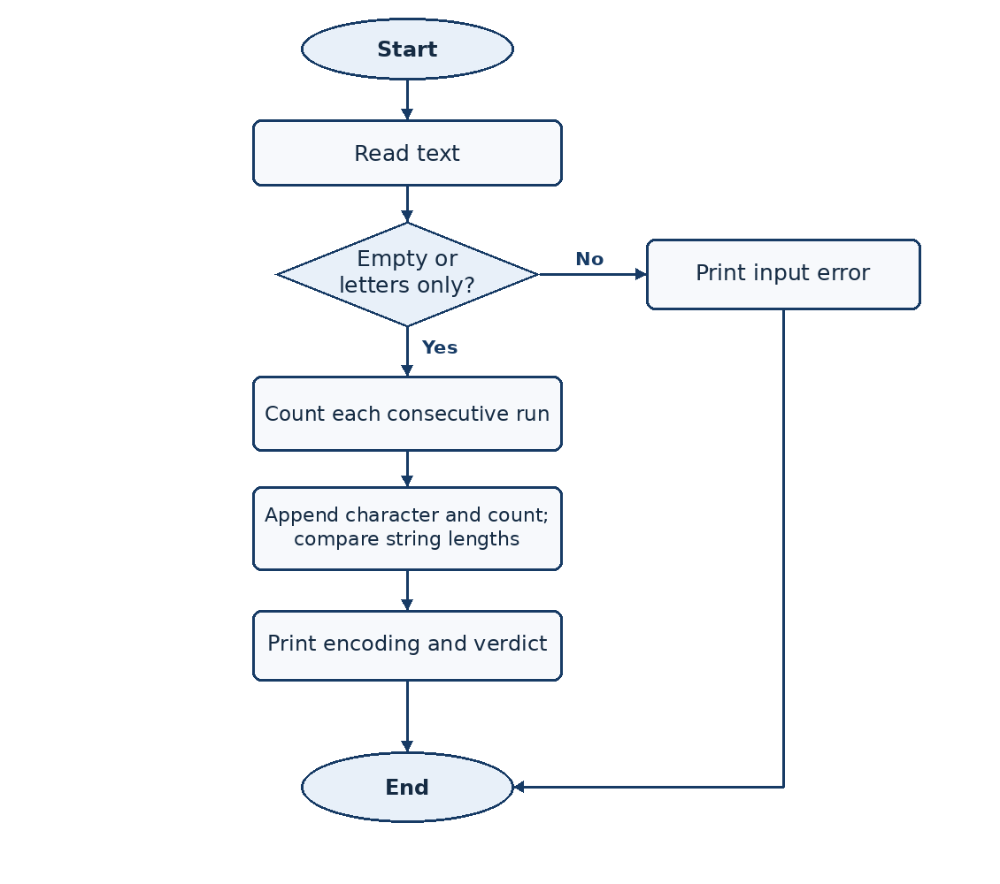
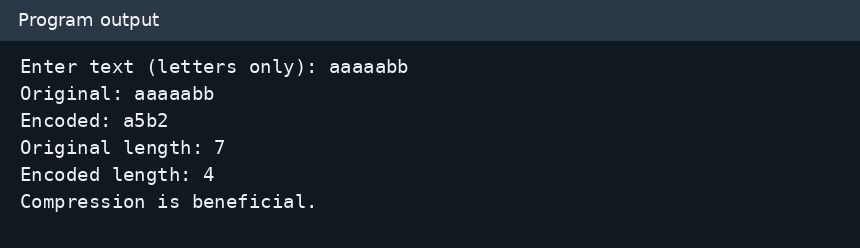

# Case Study 35: Text Compression Using Character Runs

## Problem statement

Encode consecutive repeated characters and compare the original and encoded lengths, including cases in which encoding is not beneficial.

## Objectives

Use a loop to group character runs and compare lengths in characters.

## Assumptions

- Input contains only letters or is empty, so the count in the encoding is not confused with a digit from the input.
- Case matters. Every run is written as its character followed by its count, including runs of length one. A shorter encoding alone is beneficial.

## Algorithm

1. Read the text; reject non-letter characters unless the text is empty.
2. Walk through the text and count each consecutive run.
3. Add the character and count to the encoded string when a run ends.
4. Print both strings, their lengths and whether the encoded string is shorter.

## Flowchart



## Pseudocode

```text
READ text
IF text is non-empty and contains non-letters THEN PRINT error
ELSE
    encoded = empty string
    IF text is not empty
        count = 1
        FOR each character after the first
            IF same as previous THEN increase count
            ELSE append previous character and count; reset count
        APPEND final character and count
    PRINT original and encoded lengths
    IF encoded length < original length THEN PRINT beneficial
    ELSE PRINT not beneficial
END IF
```

## Python source code

```python
# Case study 35: Text Compression Using Character Runs
# Only letters are used so that counts can be distinguished from text.

text = input("Enter text (letters only): ")
if text and not text.isalpha():
    print("Invalid input: use letters only.")
else:
    encoded = ""
    if text:
        count = 1
        for index in range(1, len(text)):
            if text[index] == text[index - 1]:
                count += 1
            else:
                encoded += text[index - 1] + str(count)
                count = 1
        encoded += text[-1] + str(count)

    print("Original:", text)
    print("Encoded:", encoded)
    print("Original length:", len(text))
    print("Encoded length:", len(encoded))
    if len(encoded) < len(text):
        print("Compression is beneficial.")
    else:
        print("Compression is not beneficial.")
```

## Test cases

| Input | Expected result | Result |
| --- | --- | --- |
| aaaaabb | a5b2, 4 characters instead of 7 | Pass |
| python | Encoding is longer and not beneficial | Pass |
| aabb | Equal length is not beneficial | Pass |
| 12 a characters | a12 with length 3 | Pass |
| Empty string | Lengths are both zero | Pass |
| aa11 | Rejected because counts would be ambiguous | Pass |
| AAaa | Uppercase and lowercase form separate runs | Pass |

[Automated test cases](test_cases.py)

## Output screenshot



[Sample input](sample_input.txt) · [Captured output](output.txt)

## Conclusion

Repeated runs can reduce the length, while short or non-repeated text may become longer.
