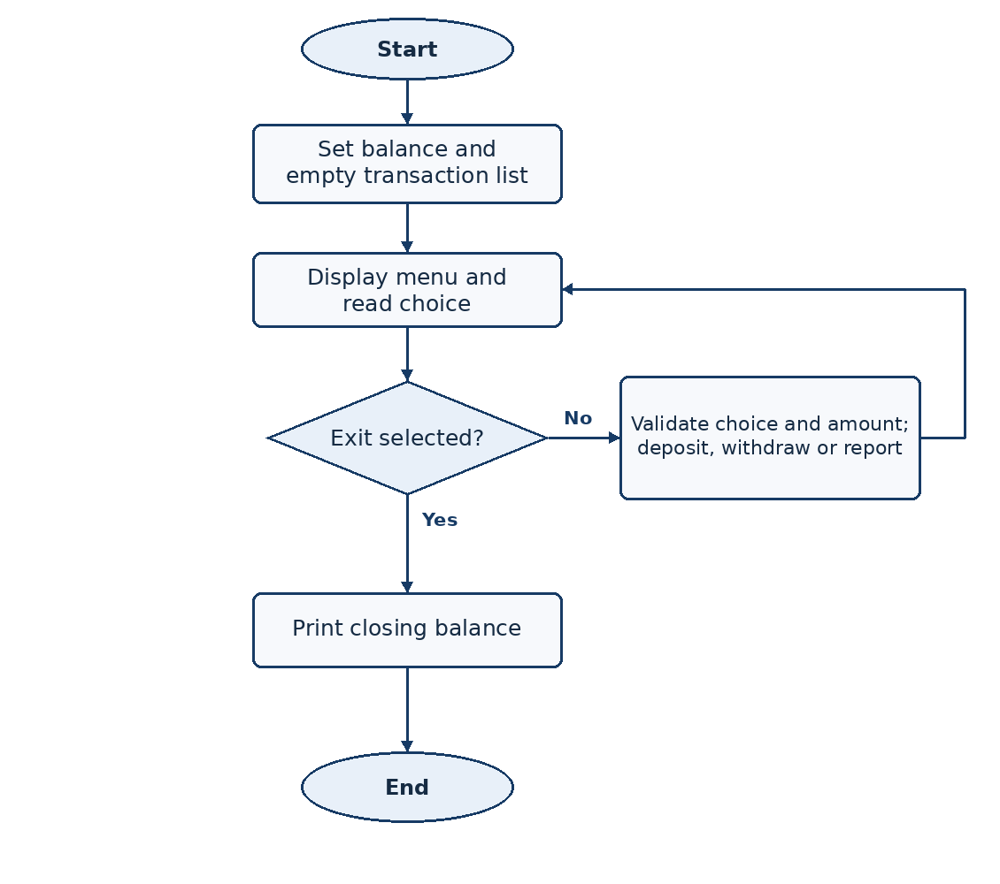
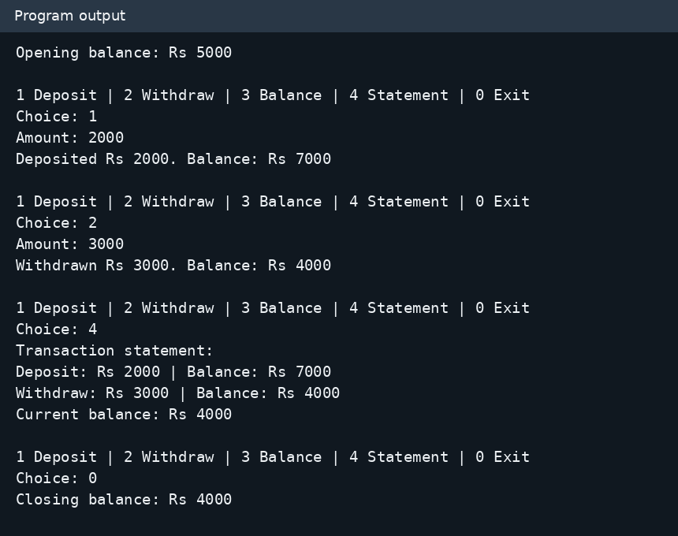

# Case Study 38: ATM Menu-Driven Banking Simulation

## Problem statement

Implement repeated ATM menu operations for deposits, withdrawals, balance inquiries and transaction summaries with validation and account limits.

## Objectives

Maintain a simulated balance and transaction list while processing menu choices.

## Assumptions

- The opening balance is Rs 5000 and at least Rs 1000 must remain. All amounts are positive whole rupees.
- A deposit is at most Rs 100000. A withdrawal is at most Rs 10000 and must be a multiple of Rs 100.
- Only successful deposits and withdrawals appear in the statement. Data is not saved after the session.

## Algorithm

1. Set the opening balance and an empty transaction list.
2. Display the menu repeatedly until the user selects exit.
3. Validate amounts and limits before changing the balance.
4. Record successful transactions, or display the balance or statement as requested.
5. Print the closing balance on exit.

## Flowchart



## Pseudocode

```text
SET balance = 5000 and transactions = empty list
REPEAT
    READ menu choice
    IF deposit or withdrawal
        READ and validate amount and account limits
        IF allowed THEN update balance and save transaction
        ELSE PRINT reason
    ELSE IF balance THEN PRINT balance
    ELSE IF statement THEN PRINT successful transactions
    ELSE IF exit THEN PRINT closing balance
    ELSE PRINT invalid choice
UNTIL exit
```

## Python source code

```python
# Case study 38: ATM Menu-Driven Banking Simulation
# All amounts are whole rupees and the balance is not saved after exit.

balance = 5000
transactions = []
print("Opening balance: Rs 5000")

while True:
    print("\n1 Deposit | 2 Withdraw | 3 Balance | 4 Statement | 0 Exit")
    choice = input("Choice: ").strip()

    if choice == "1" or choice == "2":
        amount_text = input("Amount: ").strip()
        if not amount_text.isdecimal() or int(amount_text) == 0:
            print("Enter a positive whole number of rupees.")
            continue
        amount = int(amount_text)
        if choice == "1":
            if amount > 100000:
                print("Deposit limit is Rs 100000.")
            else:
                balance += amount
                transactions.append(("Deposit", amount, balance))
                print(f"Deposited Rs {amount}. Balance: Rs {balance}")
        else:
            if amount % 100 != 0:
                print("Withdrawal must be a multiple of Rs 100.")
            elif amount > 10000:
                print("Withdrawal limit is Rs 10000.")
            elif balance - amount < 1000:
                print("Minimum balance of Rs 1000 must remain.")
            else:
                balance -= amount
                transactions.append(("Withdraw", amount, balance))
                print(f"Withdrawn Rs {amount}. Balance: Rs {balance}")
    elif choice == "3":
        print(f"Balance: Rs {balance}")
    elif choice == "4":
        print("Transaction statement:")
        if not transactions:
            print("No successful transactions.")
        for kind, amount, new_balance in transactions:
            print(f"{kind}: Rs {amount} | Balance: Rs {new_balance}")
        print(f"Current balance: Rs {balance}")
    elif choice == "0":
        print(f"Closing balance: Rs {balance}")
        break
    else:
        print("Invalid choice.")
```

## Test cases

| Input | Expected result | Result |
| --- | --- | --- |
| Deposit 2000, withdraw 3000, statement | Balance 4000 and both operations in statement | Pass |
| Withdraw 4000 from 5000 | Allowed; exactly 1000 remains | Pass |
| Withdraw 4100 from 5000 | Rejected and not recorded | Pass |
| Deposit 100001, withdraw 10100 and 150 | Each limit or denomination failure rejected | Pass |
| NaN, -2 and 0 as deposits | All rejected; balance unchanged | Pass |
| Option 9 then exit | Invalid option does not end session | Pass |

[Automated test cases](test_cases.py)

## Output screenshot



[Sample input](sample_input.txt) · [Captured output](output.txt)

## Conclusion

The menu updates the balance only for valid transactions and keeps a simple statement of successful operations.
