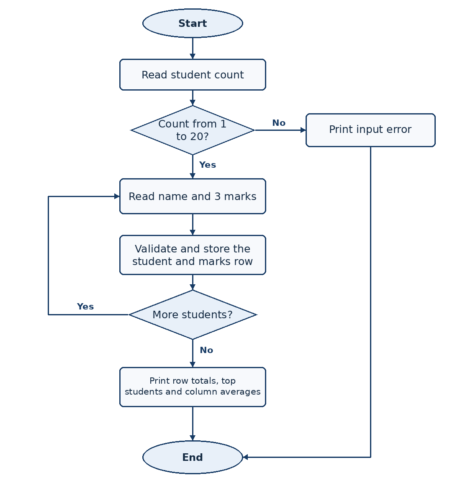
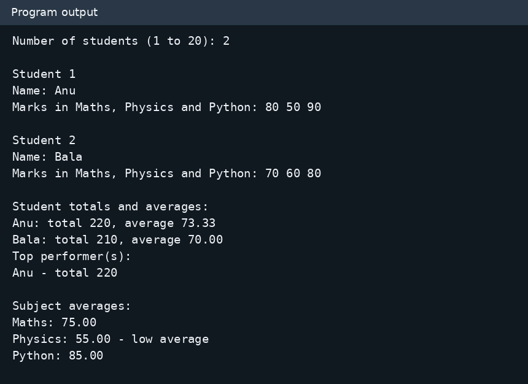

# Case Study 42: Student Marks Matrix Analysis

## Problem statement

Analyse a matrix of student marks, calculate student and subject statistics, identify top performers and detect subjects with low averages.

## Objectives

Use a nested list for marks and calculate row-wise and column-wise results.

## Assumptions

- There are three subjects: Maths, Physics and Python. Each mark is a whole number from 0 to 100; the number of students is from 1 to 20.
- A subject average below 60 is low. All students tied for the highest total are listed. Invalid records are skipped.

## Algorithm

1. Read the number of students and validate it.
2. Read each name and three marks, saving valid rows in a matrix.
3. If no records are valid, print a message and stop.
4. Calculate each student total and average and list every top performer.
5. Calculate each subject average from the valid rows and flag low averages.

## Flowchart



## Pseudocode

```text
READ student_count
IF count is invalid THEN PRINT error
ELSE
    FOR each student
        READ name and 3 marks
        IF valid THEN ADD name and marks row
        ELSE PRINT error
    IF matrix is empty THEN PRINT no valid records
    ELSE
        FOR each row PRINT total and average
        PRINT all students with the highest total
        FOR each column PRINT average and low-average flag
END IF
```

## Python source code

```python
# Case study 42: Student Marks Matrix Analysis
# Each row is a student and each column is a subject.

subjects = ["Maths", "Physics", "Python"]
count_text = input("Number of students (1 to 20): ").strip()
if not count_text.isdecimal() or not 1 <= int(count_text) <= 20:
    print("Enter a number from 1 to 20.")
else:
    names = []
    matrix = []
    for number in range(int(count_text)):
        print("\nStudent", number + 1)
        name = input("Name: ").strip()
        parts = input("Marks in Maths, Physics and Python: ").split()
        row = []
        valid = bool(name) and len(parts) == 3
        if valid:
            for part in parts:
                if not part.isdecimal() or int(part) > 100:
                    valid = False
                    break
                row.append(int(part))
        if valid:
            names.append(name)
            matrix.append(row)
        else:
            print("Invalid record: enter a name and 3 marks from 0 to 100.")

    if not matrix:
        print("\nNo valid student records.")
    else:
        print("\nStudent totals and averages:")
        highest_total = -1
        for row in range(len(matrix)):
            total = sum(matrix[row])
            average = total / len(subjects)
            print(f"{names[row]}: total {total}, average {average:.2f}")
            if total > highest_total:
                highest_total = total
        print("Top performer(s):")
        for row in range(len(matrix)):
            if sum(matrix[row]) == highest_total:
                print(names[row], "- total", highest_total)

        print("\nSubject averages:")
        for column in range(len(subjects)):
            total = 0
            for row in range(len(matrix)):
                total += matrix[row][column]
            average = total / len(matrix)
            if average < 60:
                print(f"{subjects[column]}: {average:.2f} - low average")
            else:
                print(f"{subjects[column]}: {average:.2f}")
```

## Test cases

| Input | Expected result | Result |
| --- | --- | --- |
| Ana: 60, 50, 70 | Total 180; Physics average 50 is low | Pass |
| Two students both total 180 | Both names reported as top performers | Pass |
| One mark above 100 and one valid row | Invalid row skipped; averages use valid row | Pass |
| Blank name | No division by zero | Pass |
| Zero students | Input rejected | Pass |

[Automated test cases](test_cases.py)

## Output screenshot



[Sample input](sample_input.txt) · [Captured output](output.txt)

## Conclusion

The matrix gives row-wise student results, column-wise subject averages and all tied top performers.
