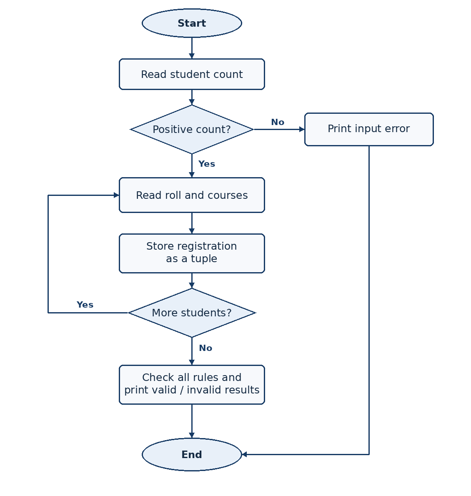
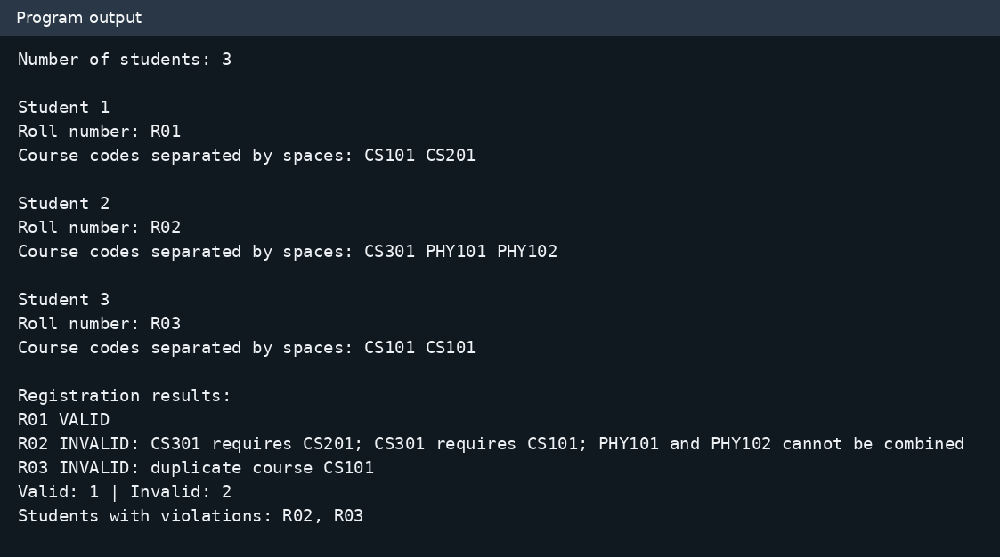

# Case Study 64: Tuple-Based Course Registration Validation

## Problem statement

Represent course registrations as tuples, detect duplicate registrations and invalid course combinations, and list students whose selections violate the rules.

## Objectives

Use tuples, unpacking and loops to validate each student registration.

## Assumptions

- Each student has a unique roll number and chooses one to five courses from CS101, CS201, CS301, MATH101, PHY101, PHY102 and ENG101.
- CS201 requires CS101; CS301 requires both CS201 and CS101 in the same registration. PHY101 and PHY102 cannot be selected together.
- Course codes and rolls are compared in uppercase. Repeated courses, unknown codes and duplicate student records are invalid.

## Algorithm

1. Read the number of student registrations.
2. Read each roll and its course codes and store them as a tuple.
3. For every registration, check the roll, course count, duplicates and unknown codes.
4. Check prerequisites and the incompatible course pair.
5. Print all violations and a count and list of invalid registrations.

## Flowchart



## Pseudocode

```text
READ student_count
IF count is invalid THEN PRINT error
ELSE
    FOR each student
        READ roll and course codes
        STORE (roll, tuple of courses)
    FOR each registration
        CHECK roll, count, duplicates and unknown codes
        CHECK prerequisites and incompatible courses
        IF errors exist THEN PRINT all errors
        ELSE PRINT valid
    PRINT valid and invalid counts
END IF
```

## Python source code

```python
# Case study 64: Tuple-Based Course Registration Validation

known_courses = ("CS101", "CS201", "CS301", "MATH101", "PHY101", "PHY102", "ENG101")
count_text = input("Number of students: ").strip()
if not count_text.isdecimal() or int(count_text) < 1:
    print("Enter a positive number of students.")
else:
    registrations = []
    for number in range(int(count_text)):
        print("\nStudent", number + 1)
        roll = input("Roll number: ").strip().upper()
        course_text = input("Course codes separated by spaces: ").upper().split()
        registrations.append((roll, tuple(course_text)))

    print("\nRegistration results:")
    seen_rolls = []
    invalid_rolls = []
    for roll, courses in registrations:
        errors = []
        if not roll:
            errors.append("roll number is required")
        elif roll in seen_rolls:
            errors.append("duplicate student record")
        else:
            seen_rolls.append(roll)
        if not courses:
            errors.append("at least one course is required")
        if len(courses) > 5:
            errors.append("more than 5 courses")

        reported = []
        for code in courses:
            if courses.count(code) > 1 and code not in reported:
                errors.append("duplicate course " + code)
                reported.append(code)
            if code not in known_courses:
                message = "unknown course " + code
                if message not in errors:
                    errors.append(message)
        if "CS201" in courses and "CS101" not in courses:
            errors.append("CS201 requires CS101")
        if "CS301" in courses and "CS201" not in courses:
            errors.append("CS301 requires CS201")
        if "CS301" in courses and "CS101" not in courses:
            errors.append("CS301 requires CS101")
        if "PHY101" in courses and "PHY102" in courses:
            errors.append("PHY101 and PHY102 cannot be combined")

        if errors:
            print((roll or "(blank)"), "INVALID:", "; ".join(errors))
            invalid_rolls.append(roll or "(blank)")
        else:
            print(roll, "VALID")
    print(f"Valid: {len(registrations) - len(invalid_rolls)} | Invalid: {len(invalid_rolls)}")
    if invalid_rolls:
        print("Students with violations:", ", ".join(invalid_rolls))
```

## Test cases

| Input | Expected result | Result |
| --- | --- | --- |
| CS101, CS201 and CS301 | Valid registration | Pass |
| CS301 with PHY101 and PHY102 | Both prerequisites and conflict reported | Pass |
| CS101 twice and ABC | Both violations reported | Pass |
| Six known courses | Rejected for exceeding limit | Pass |
| No courses | Registration rejected | Pass |
| Two records for R1 | Second record rejected | Pass |

[Automated test cases](test_cases.py)

## Output screenshot



[Sample input](sample_input.txt) · [Captured output](output.txt)

## Conclusion

The registration check reports all applicable violations, including prerequisite and duplicate-course errors.
