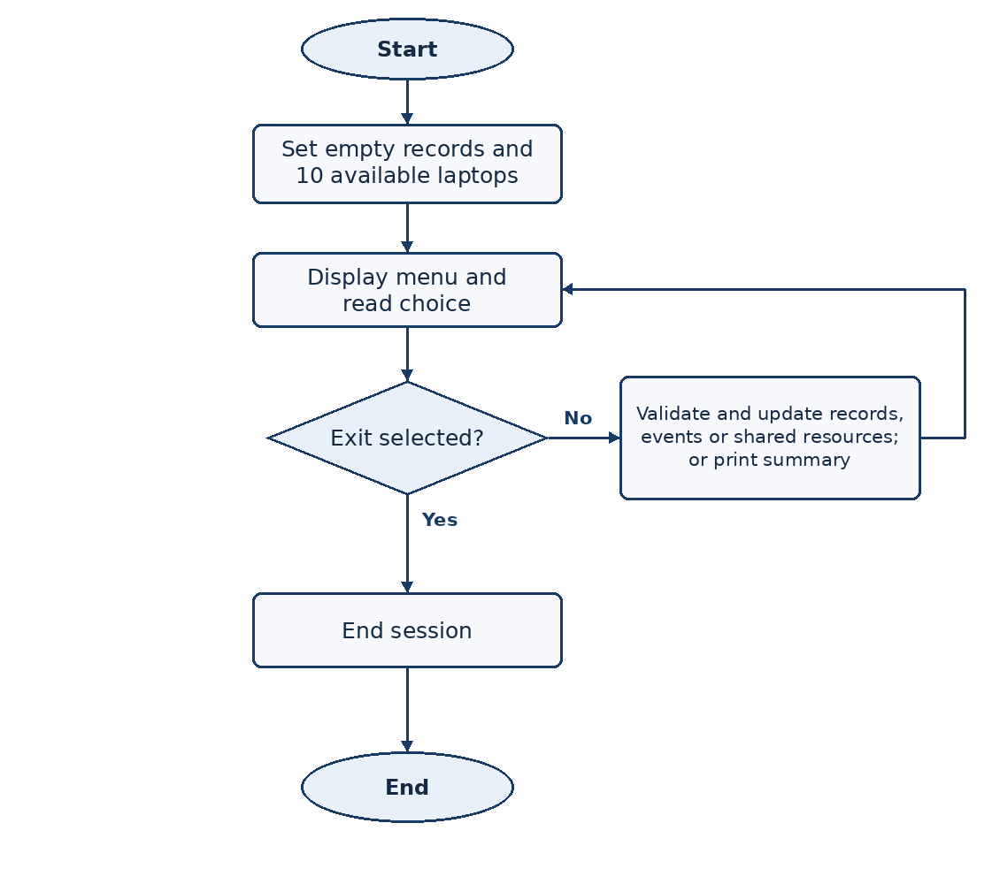
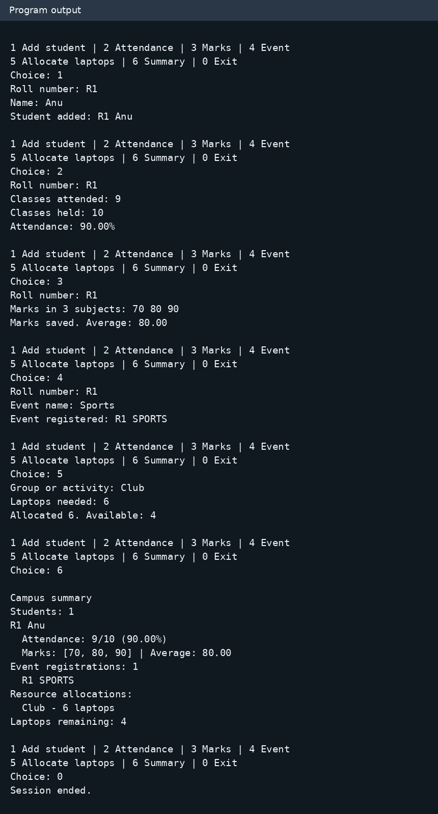

# Case Study 100: Comprehensive Smart Campus Management Simulation

## Problem statement

Develop a menu-driven program that integrates student records, attendance, marks, event registration, resource allocation and summary reporting.

## Objectives

Use lists, nested lists, tuples and a menu loop to maintain and report a small set of campus records.

## Assumptions

- All data is held in memory only. Student roll numbers are unique. Attendance requires classes held greater than zero and attended no greater than held.
- Three whole-number marks from 0 to 100 are recorded for a student. An attendance or marks update replaces that student's earlier value.
- An event cannot be registered twice by the same student. Ten laptops are shared across activities; requests above the remaining count are rejected.

## Algorithm

1. Start with empty student, event and resource lists and ten available laptops.
2. Display a menu until exit is selected.
3. Add students or update attendance and marks only after validating the inputs.
4. Register events without duplicates and allocate laptops without exceeding the remaining stock.
5. Print a summary of students, attendance, marks, event registrations and resources.

## Flowchart



## Pseudocode

```text
SET empty student, event and allocation lists
SET available laptops = 10
REPEAT
    READ menu choice
    IF add student THEN validate and save student
    ELSE IF attendance or marks THEN validate and update record
    ELSE IF event THEN reject duplicates or save registration
    ELSE IF allocation THEN check and update available laptops
    ELSE IF summary THEN PRINT all current records
    ELSE IF choice is not exit THEN PRINT invalid choice
UNTIL exit
```

## Python source code

```python
# Case study 100: Comprehensive Smart Campus Management Simulation
# Data is kept only during the current program session.

# Student row: roll, name, classes attended, classes held, three marks
students = []
events = []                 # (roll, event name)
allocations = []            # (group, number of laptops)
available = 10

while True:
    print("\n1 Add student | 2 Attendance | 3 Marks | 4 Event")
    print("5 Allocate laptops | 6 Summary | 0 Exit")
    choice = input("Choice: ").strip()

    if choice == "1":
        roll = input("Roll number: ").strip().upper()
        exists = False
        for student in students:
            if student[0] == roll:
                exists = True
        if not roll:
            print("Roll number is required.")
            continue
        if exists:
            print("Student already exists.")
            continue
        name = input("Name: ").strip()
        if not name:
            print("Name is required.")
        else:
            students.append([roll, name, None, None, []])
            print("Student added:", roll, name)

    elif choice in ("2", "3", "4"):
        roll = input("Roll number: ").strip().upper()
        index = -1
        for position in range(len(students)):
            if students[position][0] == roll:
                index = position
                break
        if index == -1:
            print("Student not found.")
            continue

        if choice == "2":
            attended_text = input("Classes attended: ").strip()
            held_text = input("Classes held: ").strip()
            if not attended_text.isdecimal() or not held_text.isdecimal():
                print("Attendance must be whole numbers.")
            else:
                attended = int(attended_text)
                held = int(held_text)
                if held == 0 or attended > held:
                    print("Invalid attendance values.")
                else:
                    students[index][2] = attended
                    students[index][3] = held
                    print(f"Attendance: {attended * 100 / held:.2f}%")
        elif choice == "3":
            parts = input("Marks in 3 subjects: ").split()
            marks = []
            valid = len(parts) == 3
            if valid:
                for part in parts:
                    if not part.isdecimal() or int(part) > 100:
                        valid = False
                        break
                    marks.append(int(part))
            if valid:
                students[index][4] = marks
                print(f"Marks saved. Average: {sum(marks) / 3:.2f}")
            else:
                print("Enter 3 whole-number marks from 0 to 100.")
        else:
            event = input("Event name: ").strip().upper()
            if not event:
                print("Event name is required.")
            elif (roll, event) in events:
                print("Already registered for this event.")
            else:
                events.append((roll, event))
                print("Event registered:", roll, event)

    elif choice == "5":
        group = input("Group or activity: ").strip()
        if not group:
            print("Group is required.")
            continue
        amount_text = input("Laptops needed: ").strip()
        if not amount_text.isdecimal() or int(amount_text) == 0:
            print("Enter a positive whole number.")
        else:
            amount = int(amount_text)
            if amount > available:
                print(f"Not enough laptops. Available: {available}")
            else:
                available -= amount
                allocations.append((group, amount))
                print(f"Allocated {amount}. Available: {available}")

    elif choice == "6":
        print("\nCampus summary")
        print("Students:", len(students))
        for roll, name, attended, held, marks in students:
            print(roll, name)
            if held is None:
                print("  Attendance: not recorded")
            else:
                print(f"  Attendance: {attended}/{held} ({attended * 100 / held:.2f}%)")
            if marks:
                print(f"  Marks: {marks} | Average: {sum(marks) / 3:.2f}")
            else:
                print("  Marks: not recorded")
        print("Event registrations:", len(events))
        for roll, event in events:
            print(" ", roll, event)
        print("Resource allocations:")
        for group, amount in allocations:
            print(" ", group, "-", amount, "laptops")
        print("Laptops remaining:", available)
    elif choice == "0":
        print("Session ended.")
        break
    else:
        print("Invalid choice.")
```

## Test cases

| Input | Expected result | Result |
| --- | --- | --- |
| Student, attendance, marks, event; allocate 6 then 5 laptops | All records shown; second allocation rejected | Pass |
| Add R1 twice, then summary and exit | Duplicate rejected; next menu choice still works | Pass |
| Attendance for unknown roll | Rejected without asking for attendance | Pass |
| Zero classes held and mark 101 | Both updates rejected | Pass |
| Same event in different letter case | Duplicate rejected | Pass |
| Allocate 10 laptops, then request 1 more | Exact capacity allowed; later request rejected | Pass |
| Unknown option and negative laptop quantity | Both rejected without a crash | Pass |

[Automated test cases](test_cases.py)

## Output screenshot



[Sample input](sample_input.txt) · [Captured output](output.txt)

## Conclusion

The program combines the requested campus functions and prevents duplicate registrations and over-allocation of shared laptops.
